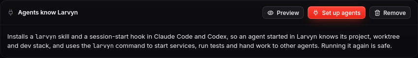
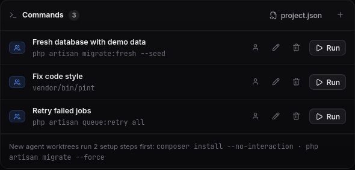
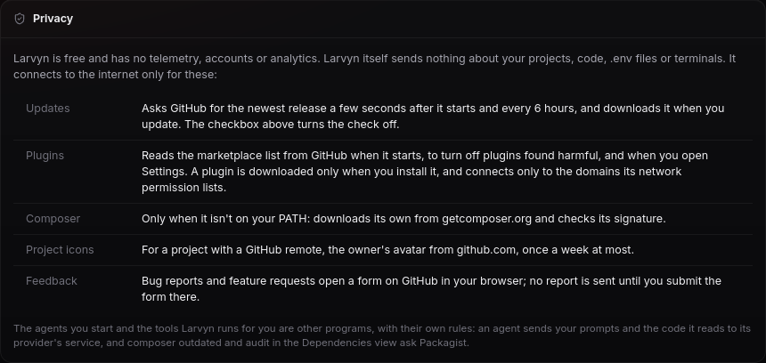

**Larvyn v0.1.0-beta.15** is out, and it’s a big one. Larvyn is now open source, agents can drive the app themselves, and there’s a new spec-first way to run them.

## Larvyn is open source

The source code is now public under the [MIT License](https://github.com/larvyn/larvyn/blob/master/LICENSE), at [github.com/larvyn/larvyn](https://github.com/larvyn/larvyn). Larvyn is still free, and always will be.

Larvyn runs your terminals and your agents, and reads your `.env`. You no longer have to take our word for what it does with them: every line is there to read. It’s a Go app built with [Wails 3](https://v3.wails.io), with a React front end, and the same repository holds the `larvyn` command and the MCP server.

- **Read it and build it.** The [README](https://github.com/larvyn/larvyn#develop) explains how the app is put together and how to run and build it from source with `wails3 dev`.
- **Fork it and change it.** MIT means you can use it at work, ship your own build and keep your changes.
- **Help shape it.** Fix the bug that bothers you, add the agent CLI you use, or send a pull request for anything on your list. Releases, [issues](https://github.com/larvyn/larvyn/issues) and [Discussions](https://github.com/larvyn/larvyn/discussions) now live in the same repository as the code.

If Larvyn is useful to you, a [star on GitHub](https://github.com/larvyn/larvyn) helps other Laravel developers find it.

## Your agents can now use Larvyn too

Until now, Larvyn was something *you* used to run agents. An agent working in one of its terminals couldn’t see what you saw: which project it was in, whether the server was running, what the last test run said. So it ran `php artisan serve` again, opened its own Vite, and read raw terminal output to guess when things were ready.

Beta.15 changes that. **Agents get the same tools you have**, through a local API, a `larvyn` command and an MCP server. They can start the dev stack and wait until it’s ready, run tests and read the failures, read the log’s errors, and start other agents and wait for their result. All of it from the project and worktree they’re in.

For you, that means an agent can check its own work before it says it’s done, and you stop finding a second `artisan serve` or Vite that an agent started on its own.

## The `larvyn` command

Every terminal Larvyn opens now has a `larvyn` command on its PATH, and knows which terminal and worktree it runs in. Here it is in the demo store, where one test fails on purpose:


- **`larvyn context`** says where you are: project, folder, branch, whether it’s an agent’s worktree, the local URL and what the dev stack is running.
- **`larvyn stack start serve --wait`** starts an item of the dev stack and returns only when it’s ready: its port answers, or its output says so (Vite’s “ready in”, the queue’s “processing jobs”). If it crashes first, you get its exit code and last lines straight away. `stack list`, `stop` and `restart` do what they say.
- **`larvyn test`** runs the suite in a terminal you can watch, then prints a summary and each failure with its `file:line`. It exits 1 when anything fails, so an agent knows without reading the output.
- **`larvyn artisan …`** runs any Artisan command in the agent’s own folder. Commands that never finish, like `serve` or `queue:work`, are refused and point to `stack` instead.
- **`larvyn logs errors --since 1h`** lists the errors in the Laravel log, with `--trace` when you want the stack trace.

There’s more: the project’s models, read-only database queries and ports. **`larvyn lock acquire db`** lets several agents take turns on something they share, like the database. A lock waits while another agent holds it, and ends after its `--ttl` or when its terminal closes.

`larvyn help` lists every command, and `--json` works on all of them. Run in an agent’s worktree, they act on that worktree and leave your main checkout alone. The [command reference](/docs/cli/) covers each one.

## Agents that start agents

An agent can now hand part of its work to another one:

```sh
larvyn agents start "Make the failing checkout test pass" --title "Out-of-stock checkout"
larvyn agents wait <id>
```

`start` works like the **Launch** button: a new worktree from the caller’s branch, the project’s setup steps, and your permission settings. `wait` returns when the agent is done (exit 0) with its screen as the report, or as soon as it needs someone (exit 2).

Here is the report from the demo. The agent fixed the checkout, and before stopping it pointed out a second failing test that its change didn’t cause:


`wait` also returns early when the agent asks a question that doesn’t ring the terminal bell, like a “do you trust this folder?” prompt, so it never mistakes a waiting agent for a finished one. Answering takes one more command, `larvyn terminal write <id> …`. So a chain of helpers can’t grow without limit, agents can start agents at most two levels below the ones you start.

Agent UIs place words with cursor moves, so in raw output “Is this a project you created?” comes out as “Isthisaprojectyoucreated”. Larvyn replays the output through a terminal emulator, and the report is the text you’d see on screen.

## MCP, a skill and a session hook

For agents that prefer MCP over a shell, **`larvyn mcp`** serves the same commands as MCP tools:

```sh
claude mcp add larvyn -- larvyn mcp
```

Read-only tools (`context`, the `list`, `read`, `status` and `wait` tools, log errors) are marked as such, so clients can run them without asking. A long `agents_wait` doesn’t block the other calls. The Laravel playbooks (CRUD, tests, N+1, security review, upgrade…) are MCP prompts too: in Claude Code they show up in the `/` menu, filled in for your project. See [MCP server](/docs/mcp/) for other clients.

To make agents use all this without being told, open **Settings → Agents know Larvyn** and click **Set up agents**:



It installs a `larvyn` skill and a session-start hook in Claude Code and Codex (`larvyn agents setup` does the same from a terminal). When an agent starts in a Larvyn terminal, the hook tells it the project, the worktree and branch, the local URL and what’s running. Anywhere else it stays silent. [Agent setup](/docs/agent-setup/) has the details.

It only sets up agents you have installed. Your settings files keep their other hooks, key order and formatting, and the old version is saved next to them as a backup. **Preview** shows every file it would touch before anything is written, and **Remove** takes out only what Larvyn added.

## Spec first (Elephant-Goldfish)

Some features are worth planning before anyone writes code. Switch the Agents composer to **Spec first** and Larvyn runs them in four steps:

1. **The Elephant** explores the code and writes a spec in `.larvyn/specs/<slug>.md`: data model, routes and validation, policies, edge cases, tests. It writes no code, and asks you in its terminal about anything unclear.
2. **The Goldfish**, a fresh agent with no memory, reads the spec cold against the code and writes a review that starts with its verdict: `READY`, `NEEDS REVISION` or `BLOCKED`. By default it’s a different agent from the author. **Revise with the Elephant** hands the review back, and the loop goes on until a review says READY.
3. **Builders** take the approved spec, each in its own worktree with a copy of it. Building without a READY review asks first.
4. **The drift check.** Another fresh agent compares each attempt with the spec and lists every requirement done, done differently or missing, plus anything nobody asked for. **Send fixes** gives that report to the builder, and you merge the best attempt.

Specs are local working files: Larvyn keeps `.larvyn/specs/` out of git and out of merges. The same workflow runs from the terminal with `larvyn specs draft|review|revise|build|drift|fix`, so an agent can run it too. More in [Spec first](/docs/spec-first/).

## Comment on an agent’s diff

The review panel from beta.13 now takes comments. Click a line number to comment on that line, or shift-click another to cover a range, like a pull request review. When you’re done, **Send comments to agent** sends them all at once, so you no longer retype file names and line numbers into the follow-up box:


The agent gets one message with every comment, its file and lines, and the code it points to:

```text
I reviewed your changes. Please address these comments:

1. app/Http/Controllers/CheckoutController.php:31
   >             $product = Product::lockForUpdate()->findOrFail($item['product_id']);
   lockForUpdate() only locks inside a transaction. Wrap the loop in DB::transaction() …
```

Comments on removed lines use the old file’s line numbers and say so. While the agent works, the diff refreshes on its own, so you can watch your comments being addressed.

## Shared project settings: `.larvyn/project.json`

Some setup belongs to the whole team: the commands everyone runs, and what a fresh agent worktree needs before it can run a test. A `.larvyn/project.json` committed with the code gives everyone who opens the repository the same setup:

```json
{
  "apiVersion": 1,
  "commands": [
    { "id": "fresh", "title": "Fresh database with demo data", "run": "php artisan migrate:fresh --seed" },
    { "id": "lint", "title": "Fix code style", "run": "vendor/bin/pint" },
    { "id": "retry", "title": "Retry failed jobs", "run": "php artisan queue:retry all" }
  ],
  "worktree": {
    "setup": ["composer install --no-interaction", "php artisan migrate --force"]
  }
}
```

- **`commands`** show up in ⌘K and in a new **Commands** card in the Overview. The people icon moves a command between “only me” and the team’s file.
- **`stack`** adds items to the dev stack, next to the built-in ones.
- **`plugins`** lists the plugins the project needs. If one is missing, off or the wrong version, the Overview says so and opens it in the Marketplace.
- **`worktree.setup`** runs in every new agent worktree, in the agent’s own terminal, before the agent starts. An agent no longer finds a worktree without `vendor/` and has to run `composer install` before its first test. If a step fails, the agent doesn’t start, and **Relaunch** starts it without the setup.



Larvyn picks up changes to the file on its own, after a `git pull` or a branch switch. A wrong entry is skipped and listed; a file that doesn’t parse keeps the last version that loaded, and the Doctor shows why. Every field is in the [project.json reference](/docs/project-json/).

## Light theme

Larvyn finally has a light theme. Pick it in **Settings → Workbench → Theme**: follow the system, light or dark. Terminals and the code editor switch with it.

## Privacy, in one place

A new **Privacy** card in **Settings → About** (and the README) now lists every connection Larvyn makes, and when. The list is short. Larvyn checks GitHub for updates, reads the plugin marketplace, downloads Composer if you don’t have it, and fetches project avatars from GitHub. It has no telemetry, accounts or analytics, and it sends nothing about your projects, code, `.env` files or terminals.



## Smaller things

- **Quieter defaults for new installs.** Agents ask before acting, only shells start again when Larvyn opens (services and agents wait for **Relaunch**), and Flock is off until you turn it on. Existing installs keep their settings.
- **macOS:** “Open a project” no longer sets off privacy prompts for Music, Photos, Desktop, Documents, Downloads or network volumes. When it skips those folders the picker says so, with **Search them too**. Folders served by Herd and Valet are searched first, on every platform.
- The breadcrumbs no longer run under the search bar in a narrow window or with a long branch name.
- **Copy and paste with the mouse.** Right-click a terminal for **Copy** and **Paste**. Inside apps that capture the mouse, like Claude Code or vim, hold **Option** on macOS, or **Shift** on Windows and Linux, while dragging to select.
- **Agents’ last rows are back.** Claude Code’s input box and status line were sometimes cut off at the bottom of a terminal. Terminals now measure themselves again once their font has loaded.
- **macOS:** the window now has its close, minimise and full screen buttons.
- **Custom agents** that you removed and added again come back after a restart, and agents that can’t resume say why and wait for **Relaunch** instead of showing garbled output.
- **Agents installed in `~/.local/bin`**, where Claude Code’s installer puts them, are found even when your shell loads slowly.

## Security fixes

The last findings from our security review are fixed:

- **Relaunched agents follow your current permission setting.** An agent started in Yolo mode no longer comes back with its skip-approvals flag after you switch to Manual.
- **The Artisan form’s copied command is properly quoted**, so a value containing `$(…)` can’t run anything when you paste the line.
- **Project files are read with a size limit.** Device files are refused, and an untracked file’s diff is no longer read through a symlink.

The new local API is a socket only your user can open, with a token that changes at every start. It is never an HTTP server, so a web page open in your browser can’t reach it.

## Also out: beta.16 and beta.17

Two small releases followed on the same day:

- **beta.16** moves releases, bug reports and Discussions to [github.com/larvyn/larvyn](https://github.com/larvyn/larvyn), next to the code. Larvyn checks for updates there from now on. There’s nothing to do on your side: older versions still update as before, and the install commands stay the same.
- **beta.17**: hovering a project icon in the left rail shows its name and path right away.

## Get started

1. Update Larvyn from inside the app, or install it from the [download section](/#install).
2. Open **Settings → Agents know Larvyn** and click **Set up agents**.
3. In any Larvyn terminal, try `larvyn context` and `larvyn help`.
4. For your next feature, switch the Agents composer to **Spec first**.

Found a bug? Use **Report a bug** at the top of the app, or [open an issue](https://github.com/larvyn/larvyn/issues/new/choose).
