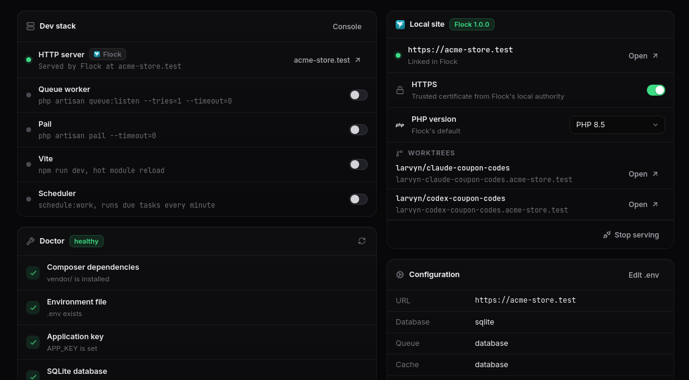
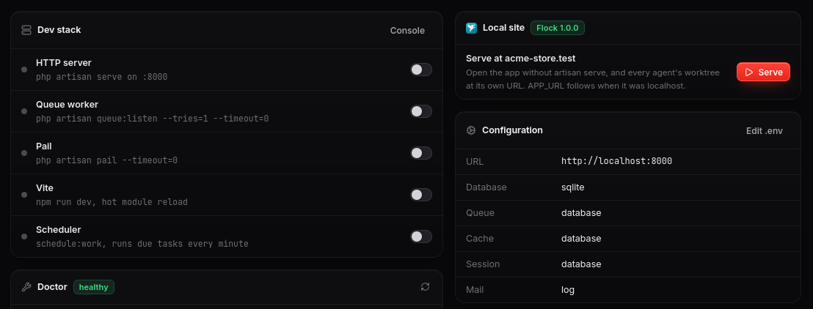
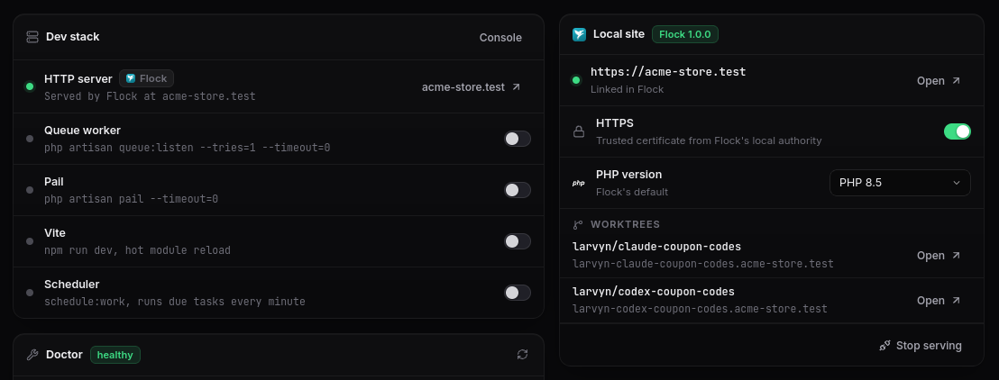
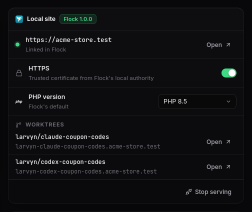
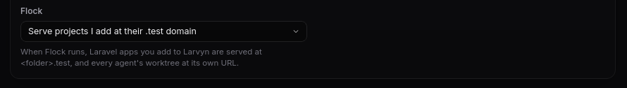

[Flock](https://flockphp.com) is a free, open source local PHP environment for Windows, macOS and Linux. It runs PHP, Node, databases and `*.test` sites with trusted HTTPS on your machine, without Docker. Larvyn now works with it: install Flock and your Laravel apps get a real domain, a PHP version of their own and HTTPS that just works, all from inside Larvyn.

Flock support ships in **Larvyn v0.1.0-beta.9**, and it’s **optional**. If you don’t install it, Larvyn looks and works exactly as before. If you do, it shows up where it helps and stays out of the way everywhere else.

*The Overview with Flock: the app is served at its own domain, and the dev stack only runs what Flock doesn’t.*

## From artisan serve to a real domain

Without a local server, Larvyn runs `php artisan serve` on a port for you. That works, but `localhost:8000` is not much like production: no HTTPS, one port per app, and cookies, subdomains and OAuth callbacks that behave differently.

When Flock is installed, the Overview gets a **Local site** card. One click on **Serve** and the app is at `<folder>.test`:

*Before: `artisan serve` on a port, and one button to serve the app with Flock.*

*After: Flock serves the app at https://acme-store.test, and the dev stack hands the HTTP server over to it.*

Larvyn also points `APP_URL` at the new address, because Laravel builds links, redirects and Vite’s URLs from it. It only does that when `APP_URL` was still empty or `localhost`, and it backs up your `.env` first. A URL you chose yourself is never overwritten; the Doctor tells you about the difference instead and fixes it with one click if you want.

Apps you add to Larvyn later are served by Flock right away. You get a short notice with their URL, and there’s a setting to turn this off.

## Everything about the site, in one card

*The Local site card, once Flock serves the app.*

- **HTTPS** is a switch. Flock serves the site with a certificate from its own local authority, which your system and browsers already trust, so there is no warning page. `APP_URL` follows to `https://`.
- **PHP version** is a picker. Choose any version and Flock uses it for this app only, on your machine, without touching the project’s files. If you pick one Flock doesn’t have yet, Larvyn downloads it through Flock and shows the progress in the card.
- **Worktrees** lists every git worktree of the app with its own URL (more on that below).
- **Stop serving** hands the app back to `artisan serve` and puts `APP_URL` back the way it was.

If Flock isn’t set up yet, the same card offers **Set up**, which runs Flock’s setup in Larvyn’s console. If its service is stopped, the card offers **Start**, which doesn’t ask for a password. While the card is on screen, Larvyn also notices within a few seconds when you start, stop or change Flock outside Larvyn, from its own app or its `flk` command.

## Every agent gets its own URL

This is the part we’re most excited about. In Larvyn you can give one task to several coding agents at once, such as Claude Code, Codex, Cursor Agent or OpenCode. Each one works in its own git worktree, on its own `larvyn/<task>` branch. Until now, comparing their results meant reading diffs.

Flock serves every git worktree of a site at its own subdomain. So when Larvyn starts an agent in a worktree, that attempt is live at its own address right away:

| Attempt | Branch | URL |
| --- | --- | --- |
| Your app | `main` | `https://acme-store.test` |
| Claude Code | `larvyn/claude-coupon-codes` | `https://larvyn-claude-coupon-codes.acme-store.test` |
| Codex | `larvyn/codex-coupon-codes` | `https://larvyn-codex-coupon-codes.acme-store.test` |

Flock also sets each worktree up: it installs Composer and npm dependencies, adjusts the `.env` for the new URL and gives Redis, the cache and Horizon their own prefixes so attempts don't take each other's jobs. Since Flock already does all of that, Larvyn skips its own installs there so the two don't race.

Each agent card in Larvyn gets a 🌐 button that opens its attempt in the browser. Click through each version, keep the one that works best, and merge it.

## What Flock covers, and what Larvyn still runs

Flock replaces `artisan serve`. It doesn't run your other dev processes, so **Start dev stack** still starts them, just without the HTTP server:

| Process | With Flock |
| --- | --- |
| HTTP server | Served by Flock at `<folder>.test`, all the time |
| Vite | Run by Larvyn. On an HTTPS site, when Vite runs through Flock’s `npm`, Flock hands it the site’s certificate, so hot reload works over HTTPS too |
| Queue worker or Horizon | Run by Larvyn |
| Scheduler, Pail, Reverb | Run by Larvyn |

The sidebar, the command palette and the Overview all show the HTTP server as served by Flock, with its URL, rather than offering to start `artisan serve` on another port.

## Going back is one click

Stop serving the app in the card and Larvyn puts back the `APP_URL` it had before, so `artisan serve` works again right away.

If Flock itself is stopped, Larvyn doesn't rewrite your `.env` behind your back. Otherwise every restart of Flock would flip your `.env` back and forth. Instead, the card offers **Use artisan serve** and the Doctor offers **Restore**, and either one puts the original `APP_URL` back.

## Optional by design

Nothing about Flock appears until Flock is installed: no card, no setting, no badge. Larvyn still detects Laravel Herd and Valet as before. If you use Flock but would rather serve apps yourself, one setting stops Larvyn from serving the apps you add:

*Settings → Flock appears only once Flock is installed.*

Under the hood, Larvyn reads Flock’s local API for the state of your sites and makes changes through Flock’s own `flk` command, exactly as you would type them. Flock stays the source of truth, and you can keep using its app and CLI alongside Larvyn.

## Try it

1. Install Flock from [flockphp.com/download](https://flockphp.com/download) and run its setup.
2. Open Larvyn and go to a Laravel project’s **Overview**.
3. Click **Serve** in the **Local site** card.

Your app is now at `https://<folder>.test`, and the next time you give a task to a few agents at once, each attempt will have a URL of its own.

Thanks to the Flock team at Guava for building such a solid local environment and documenting its CLI and API so well. Flock is a trademark of Guava s.r.o., and Larvyn isn’t affiliated with it.
